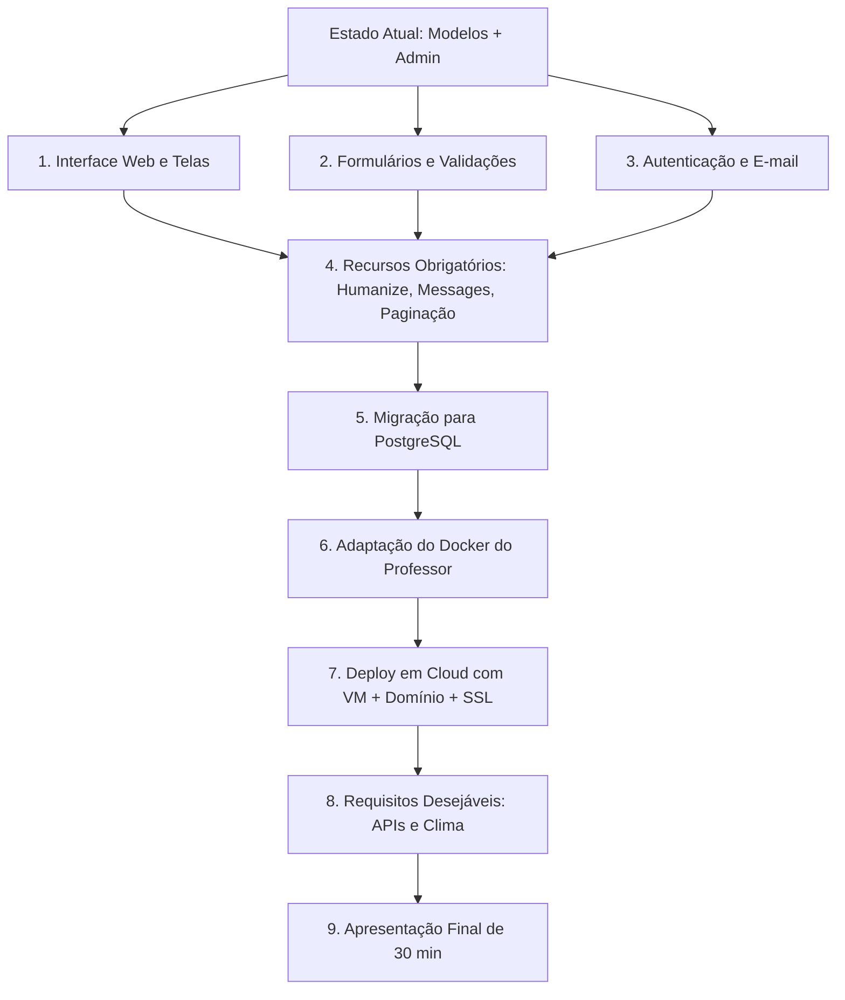

# 📚 Documentação - Projeto RotaAlt

> **Disciplina:** Sistemas Distribuídos  
> **Sistema:** RotaAlt — Plataforma de Gestão de Transporte Alternativo  
> **Framework:** Python 3 + Django  
> **Status:** Entregas I e II Concluídas (Modelos e Admin); Preparando Entrega III (Views e Forms) e Entrega IV (Deploy Cloud, Docker e Domínio).

---

## 📑 Sumário

1. [Visão Geral do Projeto](#1-visão-geral-do-projeto)
2. [Estrutura de Pastas e Arquivos](#2-estrutura-de-pastas-e-arquivos)
3. [O Que Já Foi Feito (Detalhamento do Código Atual)](#3-o-que-já-foi-feito-detalhamento-do-código-atual)
   - [3.1 Aplicação `contas`](#31-aplicação-contas)
   - [3.2 Aplicação `transporte`](#32-aplicação-transporte)
   - [3.3 Aplicação `reservas`](#33-aplicação-reservas)
   - [3.4 Configurações Globais (`rotaalt`)](#34-configurações-globais-rotaalt)
   - [3.5 Script de Carga de Dados (`populate.py`)](#35-script-de-carga-de-dados-populatepy)
   - [3.6 Ambiente Local e Virtualização (`Vagrantfile`)](#36-ambiente-local-e-virtualização-vagrantfile)
4. [Tabelas do Banco de Dados Geradas](#4-tabelas-do-banco-de-dados-geradas)
5. [O Que Falta Fazer e Modificações Futuras](#5-o-que-falta-fazer-e-modificações-futuras)
   - [5.1 Interface Web, Views e Templates (O Site)](#51-interface-web-views-e-templates-o-site)
   - [5.2 Formulários e Validações de Negócio (`forms.py`)](#52-formulários-e-validações-de-negócio-formspy)
   - [5.3 Autenticação Completa e Envio de E-mails](#53-autenticação-completa-e-envio-de-e-mails)
   - [5.4 Recursos Nativos do Django (Humanize, Messages, Paginação)](#54-recursos-nativos-do-django-humanize-messages-paginação)
   - [5.5 Migração de Banco de Dados (SQLite → PostgreSQL)](#55-migração-de-banco-de-dados-sqlite--postgresql)
   - [5.6 Integração com a Infraestrutura Docker do Professor](#56-integração-com-a-infraestrutura-docker-do-professor)
   - [5.7 Alocação na Nuvem, Domínio Próprio e SSL](#57-alocação-na-nuvem-domínio-próprio-e-ssl)
   - [5.8 Requisitos Desejáveis (APIs Externa e Interna)](#58-requisitos-desejáveis-apis-externa-e-interna)
   - [5.9 Slides e Apresentação Final](#59-slides-e-apresentação-final)

---

## 1. Visão Geral do Projeto

O **RotaAlt** é um sistema web distribuído voltado para a organização, oferta e reserva de viagens no segmento de **transporte alternativo** (vans, micro-ônibus e lotações intermunicipais/regionais). 

O sistema conecta:
* **Passageiros:** Que buscam trajetos, horários, tarifas e reservam assentos antecipadamente.
* **Operadores/Cooperativas:** Que gerenciam a frota, rotas atendidas e cadastros operacionais.
* **Motoristas:** Vinculados às viagens e veículos designados.

---

## 2. Estrutura de Pastas e Arquivos

Abaixo está o mapa completo do repositório, com a finalidade de cada diretório e componente:

```text
Projeto_SD/
├── contas/                     # Aplicação de gestão de usuários e perfis estendidos
│   ├── migrations/             # Histórico de migrações do banco de dados deste app
│   │   └── 0001_initial.py     # Criação da tabela contas_perfil
│   ├── admin.py                # Customização do Django Admin para Perfis e Usuários
│   ├── apps.py                 # Configuração da aplicação 'contas'
│   ├── models.py               # Modelo Perfil (OneToOne com django.contrib.auth.models.User)
│   ├── tests.py                # Testes unitários do app contas
│   └── views.py                # Visões do app (atualmente vazio, a ser implementado)
│
├── transporte/                 # Aplicação central de logística e transporte
│   ├── migrations/             # Migrações do banco
│   │   └── 0001_initial.py     # Criação das 7 tabelas de transporte
│   ├── admin.py                # Customização avançada com múltiplos inlines, filtros e buscas
│   ├── apps.py                 # Configuração da aplicação 'transporte'
│   ├── models.py               # Operador, Veiculo, Motorista, Parada, Rota, ParadaRota, Viagem
│   ├── tests.py                # Testes unitários do app transporte
│   └── views.py                # Visões do app (a ser implementado com busca e listagem)
│
├── reservas/                   # Aplicação de transações de passageiros
│   ├── migrations/             # Migrações do banco
│   │   └── 0001_initial.py     # Criação das tabelas Reserva e Avaliacao
│   ├── admin.py                # Admin para monitorar reservas, cancelamentos e avaliações
│   ├── apps.py                 # Configuração da aplicação 'reservas'
│   ├── models.py               # Modelos Reserva e Avaliacao
│   ├── tests.py                # Testes unitários do app reservas
│   └── views.py                # Visões para reservar vagas e registrar feedbacks
│
├── rotaalt/                    # Pacote de configuração do projeto Django
│   ├── asgi.py                 # Ponto de entrada ASGI (para servidores assíncronos)
│   ├── settings.py             # Configurações globais (banco, apps instalados, middlewares, fuso)
│   ├── urls.py                 # Roteamento raiz do projeto (atualmente aponta para /admin/)
│   └── wsgi.py                 # Ponto de entrada WSGI (usado em produção com Gunicorn)
│
├── Material/                   # Diretório com os materiais fornecidos pelo professor
│   ├── Docker_Projeto_Web_CS.pdf                     # Manual explicativo de Docker e arquitetura Web
│   ├── Projeto Sistemas Distribuídos (CCMP0054).md   # Especificações oficiais do trabalho e notas
│   ├── Projeto_SD_entrega2.zip                       # Backup entregue na Entrega II
│   └── projetosd_docker/                             # Stack Docker pronta fornecida pelo professor
│       └── projetosd_docker/
│           ├── docker-compose.yml                    # Orquestração (Nginx, Postgres, pgAdmin, SSL, Web)
│           ├── Dockerfile                            # Imagem Docker do Django
│           ├── gunicorn-cfg.py                       # Configuração do servidor de aplicação Gunicorn
│           ├── instrucoes.txt                        # Instruções de adaptação para o grupo
│           ├── servers.json                          # Configuração de auto-conexão do pgAdmin
│           ├── nginx/ & proxy/                       # Configurações do Nginx / Proxy reverso
│           └── ssl/                                  # Scripts de emissão SSL Let's Encrypt / getssl
│
├── credenciais.txt             # Usuários, e-mails e senhas de teste gerados para o sistema
├── db.sqlite3                  # Banco de dados relacional SQLite local de desenvolvimento
├── manage.py                   # Utilitário CLI padrão do Django
├── populate.py                 # Script automatizado que alimenta o banco com dados realistas
├── pyrightconfig.json          # Configuração de linting e checagem de tipos estáticos
├── README.md                   # Instruções de setup inicial via Vagrant
├── requirements.txt            # Dependências Python instaladas no ambiente
└── Vagrantfile                 # Script de provisionamento da máquina virtual Ubuntu no VirtualBox
```

---

## 3. O Que Já Foi Feito (Detalhamento do Código Atual)

### 3.1 Aplicação `contas`

Responsável por gerenciar os tipos de usuários que acessam o sistema, estendendo o modelo nativo `User` do Django sem quebrar a compatibilidade com a autenticação padrão.

#### Modelo: `Perfil` (`contas/models.py`)
```python
class Perfil(models.Model):
    TIPO_CHOICES = [
        ('passageiro', 'Passageiro'),
        ('motorista', 'Motorista'),
        ('gestor', 'Gestor'),
    ]
    usuario = models.OneToOneField(
        User, on_delete=models.CASCADE, related_name='perfil',
        verbose_name='Usuário'
    )
    tipo = models.CharField(max_length=20, choices=TIPO_CHOICES, default='passageiro')
    telefone = models.CharField(max_length=20, blank=True)
    cpf = models.CharField(max_length=14, unique=True, blank=True, null=True)
    data_nascimento = models.DateField(null=True, blank=True)
```
* **Destaques:**
  * Uso de `OneToOneField` com o `User` do Django, permitindo adicionar campos obrigatórios de negócio (`cpf`, `telefone`, `tipo`, `data_nascimento`) mantendo o sistema de senhas criptografadas do framework.
  * Separação de papéis via `TIPO_CHOICES` para controle de permissões futuro nas views.

#### Admin Customizado (`contas/admin.py`)
* O `UserAdmin` padrão do Django foi desregistrado e re-registrado (`admin.site.unregister(User)` / `admin.site.register(User, UserAdmin)`).
* Foi embutido o `PerfilInline` do tipo `StackedInline` diretamente na tela de edição do Usuário. Ao cadastrar ou alterar um usuário, os dados do perfil (CPF, tipo, telefone) são editados na mesma tela.
* Adicionada coluna customizada `@admin.display(description='Tipo')` para listar se o usuário é Passageiro, Motorista ou Gestor na listagem geral.

---

### 3.2 Aplicação `transporte`

É o coração do sistema, englobando 7 modelos inter-relacionados para cobrir toda a logística de transporte alternativo:

1. **`Operador`:** Representa a cooperativa ou empresa dona dos veículos (nome, CNPJ único, contato).
2. **`Veiculo`:** Veículos da frota vinculados a um operador (placa única, tipo [van, micro-ônibus, etc.], capacidade de passageiros, ano).
3. **`Motorista`:** Vincula um `Perfil` (usuário) a um `Operador`, registrando número e categoria da CNH (ex: D).
4. **`Parada`:** Pontos de embarque/desembarque com nome, endereço, referência e coordenadas geográficas (`latitude` e `longitude` decimais).
5. **`Rota`:** Linha operada (ex: *Petrolina x Juazeiro*, *Petrolina x Afrânio*), associada ao Operador.
6. **`ParadaRota` (Tabela Intermediária `through`):** Modela a sequência das paradas de uma rota:
   ```python
   class ParadaRota(models.Model):
       rota = models.ForeignKey(Rota, on_delete=models.CASCADE, related_name='paradas_ordenadas')
       parada = models.ForeignKey(Parada, on_delete=models.CASCADE)
       ordem = models.PositiveIntegerField(verbose_name='Ordem')
       tempo_estimado = models.DurationField(null=True, blank=True)
       
       class Meta:
           unique_together = [('rota', 'ordem'), ('rota', 'parada')]
   ```
   *Garante integridade:* Uma parada não pode se repetir na mesma rota e não podem existir duas paradas com o mesmo número de ordem na mesma rota.
7. **`Viagem`:** A instância prática da rota com dia, horário de saída, veículo escalado, motorista, quantidade de vagas disponíveis, preço da passagem (R$) e status (`agendada`, `em_andamento`, `concluida`, `cancelada`).

#### Admin Avançado de Transporte (`transporte/admin.py`)
* **Inlines inteligentes cruzados:**
  * Dentro da tela do **Operador**, é possível ver e cadastrar diretamente seus **Veículos**, **Motoristas** e **Rotas**.
  * Dentro da **Rota**, é possível ordenar as **Paradas** com tempo estimado (`ParadaRotaInline`) e visualizar as **Viagens** programadas.
* Otimização de performance no banco usando `list_select_related` para evitar consultas excessivas (*problema N+1*).
* Filtros por status, tipo de veículo, categoria de CNH e busca por placas ou nomes de cidades.

---

### 3.3 Aplicação `reservas`

Modela as interações e transações dos passageiros com o sistema:

1. **`Reserva`:** 
   * Liga um passageiro (`User`) a uma `Viagem`.
   * Contém status (`confirmada`, `cancelada`, `utilizada`), quantidade de vagas e data de cancelamento.
   * `unique_together = [('viagem', 'passageiro')]`: Garante que um mesmo passageiro possua apenas uma reserva por viagem, evitando duplicidade acidental.
2. **`Avaliacao`:**
   * Permite ao passageiro avaliar a viagem realizada com nota de 1 a 5 (restringida com `MinValueValidator(1)` e `MaxValueValidator(5)`) e comentário em texto livre.

#### Admin de Reservas (`reservas/admin.py`)
* Utilização de `date_hierarchy = 'data_reserva'`, permitindo navegação cronológica por ano, mês e dia.
* Inlines `ReservaInline` e `AvaliacaoInline` expostos para reutilização dentro do módulo de transporte.

---

### 3.4 Configurações Globais (`rotaalt`)

* **`settings.py`:**
  * `INSTALLED_APPS`: Inclui os apps padrão de autenticação, sessões, admin e os 3 apps customizados (`contas`, `transporte`, `reservas`).
  * `LANGUAGE_CODE = 'pt-br'` e `TIME_ZONE = 'America/Sao_Paulo'` configurados.
  * Banco de dados local apontando para SQLite3.
* **`urls.py`:**
  * Personalização estética do cabeçalho do Django Admin:
    ```python
    admin.site.site_header = 'RotaAlt - Administração'
    admin.site.site_title = 'RotaAlt Admin'
    admin.site.index_title = 'Painel de Gestão'
    ```

---

### 3.5 Script de Carga de Dados (`populate.py`)

O script cria um ambiente de teste pronto para uso com dados consistentes:
* **1 Superusuário / Administrador Geral:** `admin` / `admin123`.
* **4 Usuários Passageiros:** com perfis completos, telefones e CPFs válidos.
* **4 Usuários Motoristas:** com CNH categorias D e E.
* **3 Cooperativas/Operadores:** (*Coopertran Petrolina*, *Expresso Sertão*, *Alternativo São Francisco*).
* **6 Veículos:** Vans Renault Master, Mercedes Sprinter e Micro-ônibus Volare.
* **8 Paradas Estratégicas:** Rodoviárias, praças e terminais de Petrolina, Juazeiro, Lagoa Grande, Santa Maria da Boa Vista e Afrânio com coordenadas de GPS.
* **4 Rotas Completas:** com paradas sequenciais e tempos de viagem calibrados.
* **8 Viagens:** distribuídas entre agendadas, em andamento e concluídas.
* **9 Reservas:** com status variados.
* **4 Avaliações:** com comentários e notas de 4 e 5.

---

### 3.6 Ambiente Local e Virtualização (`Vagrantfile`)

* Provisionamento automatizado de uma máquina virtual Linux Ubuntu via Vagrant e VirtualBox.
* Configurado com **Port Forwarding** (`config.vm.network "forwarded_port", guest: 8000, host: 8000`), permitindo que o servidor Django rodando dentro da VM seja acessado no navegador do Windows via `http://localhost:8000`.

---

## 4. Tabelas do Banco de Dados Geradas

Atualmente, ao executar `python manage.py migrate`, o Django gera **20 tabelas**:

| Categoria | Tabela no Banco | Modelo / Origem | Finalidade |
| :--- | :--- | :--- | :--- |
| **Negócio (`contas`)** | `contas_perfil` | `Perfil` | Tipo de perfil, CPF, telefone e nascimento |
| **Negócio (`transporte`)** | `transporte_operador` | `Operador` | Cooperativas e empresas |
| | `transporte_veiculo` | `Veiculo` | Placas, tipos e capacidades dos veículos |
| | `transporte_motorista` | `Motorista` | CNH e vínculo de motoristas a operadores |
| | `transporte_parada` | `Parada` | Pontos físicos e coordenadas GPS |
| | `transporte_rota` | `Rota` | Linhas e itinerários de transporte |
| | `transporte_paradarota` | `ParadaRota` | Relação N:N ordenada de paradas por rota |
| | `transporte_viagem` | `Viagem` | Viagens agendadas, datas, vagas e preço |
| **Negócio (`reservas`)** | `reservas_reserva` | `Reserva` | Registro de passagens reservadas |
| | `reservas_avaliacao` | `Avaliacao` | Notas de 1 a 5 e feedback da viagem |
| **Infraestrutura Django** | `auth_user` | `django.contrib.auth` | Contas de login, e-mails e senhas hash |
| | `auth_group` | `django.contrib.auth` | Grupos de permissões |
| | `auth_permission` | `django.contrib.auth` | Permissões atômicas de CRUD |
| | `auth_user_groups` | `django.contrib.auth` | Vínculo N:N Usuário ↔ Grupo |
| | `auth_user_user_permissions` | `django.contrib.auth` | Vínculo N:N Usuário ↔ Permissão direta |
| | `auth_group_permissions` | `django.contrib.auth` | Vínculo N:N Grupo ↔ Permissão |
| | `django_admin_log` | `django.contrib.admin` | Log de auditoria de alterações no /admin/ |
| | `django_session` | `django.contrib.sessions` | Sessões ativas de navegação e cookies |
| | `django_content_type` | `django.contrib.contenttypes` | Catálogo interno de tabelas registradas |
| | `django_migrations` | `django.db.migrations` | Controle de versionamento das migrações |

---

## 5. O Que Falta Fazer e Modificações Futuras

Com base nas exigências do professor para a **Entrega III** e a **Entrega IV**, abaixo estão todas as alterações e novas implementações planejadas:



---

### 5.1 Interface Web, Views e Templates (O Site)
* **Situação Atual:** Atualmente só existe a interface do Django Admin. As `views.py` estão vazias e não há pasta de templates HTML.
* **O que será criado:**
  * Criação do diretório central `templates/` com herança de template:
    * `base.html`: Cabeçalho de navegação (Navbar), área para alertas de mensagens, rodapé responsivo e links para CSS/JS (Bootstrap 5 ou Tailwind).
  * Telas públicas do sistema:
    * `home.html`: Página inicial com apresentação do serviço e formulário rápido de busca de viagens.
    * `viagens/lista.html`: Catálogo de viagens disponíveis com filtros de origem, destino e data.
    * `viagens/detalhe.html`: Página detalhada da viagem com itinerário, mapa de paradas e botão de reserva.
    * `passageiro/painel.html`: Área do passageiro com histórico de reservas, comprovante digital e botão para cancelamento.
    * `passageiro/avaliar.html`: Formulário para avaliar a viagem concluída.
  * Configuração de rotas de usuário em `transporte/urls.py`, `reservas/urls.py` e `contas/urls.py`, integradas no [rotaalt/urls.py](file:///c:/Users/paiva/Projeto_SD/rotaalt/urls.py).

---

### 5.2 Formulários e Validações de Negócio (`forms.py`)
* **O que será implementado:**
  * Criação dos arquivos `forms.py` em cada app utilizando `forms.ModelForm`:
    * `contas/forms.py`: `CadastroUsuarioForm` (validação de CPF, checagem de formato de telefone e senhas coincidentes).
    * `reservas/forms.py`: `ReservaForm` e `AvaliacaoForm`.
  * **Regras de validação estritas:**
    * Impedir que um passageiro reserve mais vagas do que a quantidade disponível no veículo (`vagas_disponiveis`).
    * Diminuir automaticamente o número de vagas da `Viagem` quando uma reserva for confirmada.
    * Impedir a reserva de viagens que já saíram ou foram canceladas.
    * Não permitir avaliação de viagens antes que o status mude para `concluida`.

---

### 5.3 Autenticação Completa e Envio de E-mails
* **Exigência Obrigatória do Professor:** Sistema de autenticação com login, logout, cadastro e **recuperação de senha por e-mail**.
* **O que será implementado:**
  * Telas customizadas de `login.html`, `logout.html` e `registro.html`.
  * Configuração das views de reset padrão do Django:
    * `PasswordResetView`
    * `PasswordResetDoneView`
    * `PasswordResetConfirmView`
    * `PasswordResetCompleteView`
  * Configuração do envio de e-mails no [rotaalt/settings.py](file:///c:/Users/paiva/Projeto_SD/rotaalt/settings.py):
    * Em desenvolvimento: `EMAIL_BACKEND = 'django.core.mail.backends.console.EmailBackend'` (imprime o e-mail e o link de troca de senha no terminal).
    * Em produção (Cloud): Configuração via SMTP (SendGrid, Mailgun, AWS SES ou Gmail com senha de app).

---

### 5.4 Recursos Nativos do Django (Humanize, Messages, Paginação)
Três itens que o professor exige nominalmente no documento de especificação:
1. **Humanização (`django.contrib.humanize`):**
   * Ativar em `INSTALLED_APPS`.
   * Usar nos templates: formatação amigável de datas (`naturaltime`, `naturalday`) e formatação monetária de tarifas (`intcomma` / formatação R$).
2. **Framework de Mensagens (`django.contrib.messages`):**
   * Integrar em `base.html` alertas de feedback estilizados:
     * *Sucesso:* "Reserva realizada com sucesso!"
     * *Erro:* "Não há vagas suficientes para essa viagem."
     * *Aviso:* "Sua reserva foi cancelada."
3. **Paginação (`Paginator`):**
   * Paginar as listagens de viagens (ex: 6 viagens por página) com botões de "Anterior" e "Próximo".

---

### 5.5 Migração de Banco de Dados (SQLite → PostgreSQL)
* **Situação Atual:** O projeto roda sobre `db.sqlite3`.
* **Alteração futura:**
  * O professor exige banco relacional de produção (Postgres/MySQL/MariaDB).
  * O arquivo [rotaalt/settings.py](file:///c:/Users/paiva/Projeto_SD/rotaalt/settings.py) será parametrizado para ler as credenciais do banco por variáveis de ambiente ou secrets, conectando ao container PostgreSQL 14 alpine fornecido pelo professor:
    ```python
    DATABASES = {
        'default': {
            'ENGINE': 'django.db.backends.postgresql',
            'NAME': os.environ.get('POSTGRES_DB', 'projetosd_db'),
            'USER': os.environ.get('POSTGRES_USER', 'postgres'),
            'PASSWORD': pg_password,
            'HOST': os.environ.get('POSTGRES_HOST', 'postgres'),
            'PORT': '5432',
        }
    }
    ```

---

### 5.6 Integração com a Infraestrutura Docker do Professor
O professor disponibilizou uma estrutura pronta em `Material/projetosd_docker/` com arquitetura completa de produção:
* **Ajustes a fazer conforme `instrucoes.txt`:**
  1. Alterar variáveis em `.env.dev` e `.env.prod`:
     * Trocar e-mails de exemplo para o e-mail do grupo.
     * Atualizar a variável `SRC_DIR` para apontar para a pasta do código Django.
  2. Substituir o nome de exemplo `projetosd` por `rotaalt` em toda a stack (nomes de containers, proxy Nginx, banco).
  3. Integrar o script de migração e carga de dados (`manage.py migrate` e `populate.py`) no script de inicialização do container (`init-services-projetosd-web.sh`).

---

### 5.7 Alocação na Nuvem, Domínio Próprio e SSL
A Entrega IV vale **70% da nota** e exige deploy real com domínio acessível na internet:
1. **Alocação de Máquina Virtual (Cloud VM):**
   * Criar uma instância na camada gratuita (AWS EC2 t2.micro, Google Cloud Compute Engine e2-micro ou Oracle Cloud Always Free).
   * Instalar Docker, Docker Compose e Git na VM.
   * Clonar o repositório do projeto na nuvem.
2. **Compra / Registro de Domínio:**
   * Registrar um domínio próprio (ex: `rotaalt.com.br`, `rotaalt.shop` ou similar).
   * Criar entradas no painel DNS do domínio:
     * Registro tipo `A`: Apontando o domínio principal `@` para o IP público da VM.
     * Registros tipo `CNAME`: Criando os subdomínios `www`, `adm` (para o pgAdmin) e `api`.
3. **Emissão de Certificado SSL (HTTPS):**
   * Utilizar a automação de SSL (Let's Encrypt / getssl) contida no container `ssl` do professor para gerar e renovar os certificados automaticamente.

---

### 5.8 Requisitos Desejáveis (APIs Externa e Interna)
Para garantir nota máxima e destaque técnico:
1. **Consumo de API Externa (Client):**
   * Integrar a previsão do tempo nos pontos de parada ou nas rotas utilizando uma API REST gratuita (como *Open-Meteo* ou *HG Brasil*), exibindo temperatura e condições climáticas na tela da viagem.
2. **Fornecimento de API Própria (Server):**
   * Criar endpoints REST (usando *Django REST Framework* ou `JsonResponse`) em `/api/viagens/` e `/api/rotas/`, permitindo que outros sistemas ou projetos consultem as rotas em tempo real.
3. **Internacionalização (i18n):**
   * Ativar suporte a múltiplos idiomas (Português / Inglês) nos textos principais da interface.

---

### 5.9 Slides e Apresentação Final
* Elaboração de apresentação de slides (30 minutos) abordando:
  * Proposta e valor do sistema RotaAlt.
  * Arquitetura em camadas e diagrama Entidade-Relacionamento (DER).
  * Arquitetura distribuída em containers Docker (Nginx, Gunicorn, PostgreSQL, pgAdmin).
  * Demonstração ao vivo do sistema em funcionamento através do domínio na nuvem.
  * Desafios enfrentados, soluções de segurança (HTTPS, proteção CSRF) e conclusões.

---

## 6. Como Rodar o Projeto Atualmente

Para executar o sistema no estágio atual (desenvolvimento local):

```bash
# 1. Iniciar a máquina virtual Vagrant
vagrant up

# 2. Conectar à VM via SSH
vagrant ssh

# 3. Dentro da VM Linux:
cd /vagrant
source ~/venv/bin/activate
pip install -r requirements.txt
python manage.py migrate
python populate.py
python manage.py runserver 0.0.0.0:8000
```

* **Acesso pelo navegador:** [http://localhost:8000/admin/](http://localhost:8000/admin/)
* **Login do Administrador:** `admin` | **Senha:** `admin123`
*(Demais credenciais de teste para passageiros e motoristas estão catalogadas no arquivo `credenciais.txt`).*
