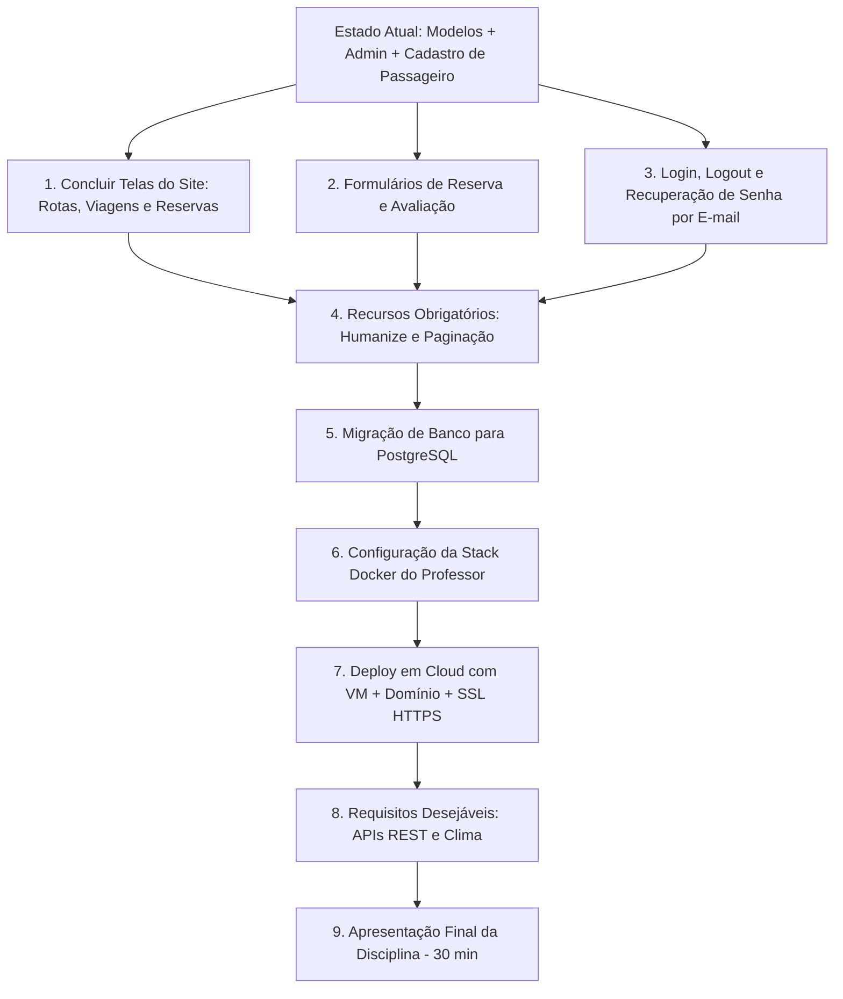

# 📚 Documentação Técnica Completa - Projeto RotaAlt

> **Disciplina:** Sistemas Distribuídos 
> **Sistema:** RotaAlt — Plataforma de Gestão de Transporte Alternativo  
> **Framework:** Python 3 + Django  
> **Status:** 
> * **Entrega I Concluída:** Ideia, especificação e requisitos definidos.
> * **Entrega II Concluída:** Modelos relacionais (10 tabelas), Django Admin avançado e script de carga (`populate.py`).
> * **Entrega III Iniciada:** Módulo de Cadastro de Passageiro funcional (Formulário com validações de unicidade, View com mensagens de feedback e Template responsivo) + Protótipo em nuvem via GitHub Pages.
> * **Próximos Passos:** Views/telas das rotas e reservas, recuperação de senha por e-mail, deploy na nuvem com PostgreSQL, Docker, domínio próprio e SSL (Entrega IV - 70%).

---

## 📑 Sumário

1. [Visão Geral do Projeto](#1-visão-geral-do-projeto)
2. [Estrutura de Pastas e Arquivos](#2-estrutura-de-pastas-e-arquivos)
3. [O Que Já Foi Feito (Detalhamento do Código Atual)](#3-o-que-já-foi-feito-detalhamento-do-código-atual)
   - [3.1 Aplicação `contas` (Modelos, Admin, Formulário e View de Cadastro)](#31-aplicação-contas)
   - [3.2 Aplicação `transporte` (Logística de Rotas, Paradas e Viagens)](#32-aplicação-transporte)
   - [3.3 Aplicação `reservas` (Controle de Passagens e Avaliações)](#33-aplicação-reservas)
   - [3.4 Roteamento Raiz e Configurações (`rotaalt`)](#34-roteamento-raiz-e-configurações-rotaalt)
   - [3.5 Script de Carga de Dados (`populate.py`)](#35-script-de-carga-de-dados-populatepy)
   - [3.6 Ambiente Local e Virtualização (`Vagrantfile`)](#36-ambiente-local-e-virtualização-vagrantfile)
   - [3.7 Protótipo Demonstrativo em Nuvem (`docs/` e `GitHub Pages`)](#37-protótipo-demonstrativo-em-nuvem-docs-e-github-pages)
4. [Tabelas do Banco de Dados Geradas](#4-tabelas-do-banco-de-dados-geradas)
5. [O Que Falta Fazer e Modificações Futuras](#5-o-que-falta-fazer-e-modificações-futuras)
   - [5.1 Interface Web, Views e Templates (O Site Completo)](#51-interface-web-views-e-templates-o-site-completo)
   - [5.2 Formulários e Validações Adicionais (`forms.py`)](#52-formulários-e-validações-adicionais-formspy)
   - [5.3 Autenticação Completa e Envio de E-mails](#53-autenticação-completa-e-envio-de-e-mails)
   - [5.4 Recursos Nativos do Django (Humanize, Messages, Paginação)](#54-recursos-nativos-do-django-humanize-messages-paginação)
   - [5.5 Migração de Banco de Dados (SQLite → PostgreSQL)](#55-migração-de-banco-de-dados-sqlite--postgresql)
   - [5.6 Integração com a Infraestrutura Docker do Professor](#56-integração-com-a-infraestrutura-docker-do-professor)
   - [5.7 Alocação na Nuvem, Domínio Próprio e SSL](#57-alocação-na-nuvem-domínio-próprio-e-ssl)
   - [5.8 Requisitos Desejáveis (APIs Externa e Interna)](#58-requisitos-desejáveis-apis-externa-e-interna)
   - [5.9 Slides e Apresentação Final (30 min)](#59-slides-e-apresentação-final-30-min)
6. [Como Rodar e Testar o Projeto](#6-como-rodar-e-testar-o-projeto)

---

## 1. Visão Geral do Projeto

O **RotaAlt** é um sistema web distribuído voltado para a organização, oferta e reserva de viagens no segmento de **transporte alternativo** (vans, micro-ônibus e lotações intermunicipais/regionais do Vale do São Francisco). 

O sistema conecta três atores principais:
* **Passageiros:** Que buscam trajetos, horários, tarifas, realizam cadastros e reservam assentos antecipadamente.
* **Operadores/Cooperativas:** Que gerenciam frotas de veículos, motoristas e linhas de transporte.
* **Motoristas:** Vinculados às viagens e veículos designados para condução dos passageiros.

O projeto foi projetado para atender aos critérios da disciplina de Sistemas Distribuídos, cobrindo modelagem relacional avançada, validações de integridade, formulários web com mensagens amigáveis, painel administrativo customizado e futura arquitetura conteinerizada em nuvem com proxy reverso e HTTPS.

---

## 2. Estrutura de Pastas e Arquivos

Abaixo está o mapa completo do repositório, refletindo as atualizações mais recentes:

```text
Projeto_SD/
├── contas/                         # Módulo de usuários, perfis e autenticação
│   ├── migrations/                 # Histórico de migrações
│   │   └── 0001_initial.py         # Criação da tabela contas_perfil
│   ├── templates/contas/           # Templates HTML do app contas
│   │   └── cadastro.html           # Tela pública de cadastro com mensagens e validações
│   ├── admin.py                    # Customização do Django Admin para Perfis e Usuários
│   ├── apps.py                     # Configuração da aplicação 'contas'
│   ├── forms.py                    # Formulário CadastroPassageiroForm (UserCreationForm estendido)
│   ├── models.py                   # Modelo Perfil (OneToOne com django.contrib.auth.models.User)
│   ├── tests.py                    # Testes unitários do app contas
│   ├── urls.py                     # Rotas do app contas (carrega a view de cadastro na raiz '/')
│   └── views.py                    # View cadastro_passageiro com suporte a GET/POST e Messages
│
├── transporte/                     # Módulo central de logística, veículos e viagens
│   ├── migrations/                 # Migrações do banco
│   │   └── 0001_initial.py         # Criação das 7 tabelas de transporte
│   ├── admin.py                    # Customização avançada com inlines múltiplos, filtros e buscas
│   ├── apps.py                     # Configuração da aplicação 'transporte'
│   ├── models.py                   # Operador, Veiculo, Motorista, Parada, Rota, ParadaRota, Viagem
│   ├── tests.py                    # Testes unitários do app transporte
│   └── views.py                    # Visões do app (a ser implementado com busca e catálogo)
│
├── reservas/                       # Módulo de transações de passageiros
│   ├── migrations/                 # Migrações do banco
│   │   └── 0001_initial.py         # Criação das tabelas Reserva e Avaliacao
│   ├── admin.py                    # Admin para monitorar reservas e avaliações
│   ├── apps.py                     # Configuração da aplicação 'reservas'
│   ├── models.py                   # Modelos Reserva e Avaliacao
│   ├── tests.py                    # Testes unitários do app reservas
│   └── views.py                    # Visões para reservar vagas e registrar feedbacks
│
├── rotaalt/                        # Pacote de configuração do projeto Django
│   ├── asgi.py                     # Ponto de entrada ASGI (servidores assíncronos)
│   ├── settings.py                 # Configurações globais (banco, apps instalados, middlewares, fuso)
│   ├── urls.py                     # Roteamento raiz (inclui contas.urls na raiz e /admin/)
│   └── wsgi.py                     # Ponto de entrada WSGI (usado em produção com Gunicorn)
│
├── docs/                           # Protótipo estático para demonstração e GitHub Pages
│   └── index.html                  # Landing page publicada em https://rennanos.github.io/Trabalho_SD/
│
├── Material/                       # Diretório de documentação, instruções e artefatos de entrega
│   ├── DOCUMENTACAO_PROJETO.md     # Esta documentação técnica viva do projeto
│   ├── INSTRUCOES_ENTREGA.txt      # Instruções de teste e validação da Entrega III para o professor
│   ├── Docker_Projeto_Web_CS.pdf   # Manual explicativo de Docker e arquitetura Web
│   ├── Projeto Sistemas Distribuídos (CCMP0054).md # Especificações oficiais do trabalho e notas
│   ├── Projeto_SD_entrega2.zip     # Arquivo compactado da Entrega II
│   └── projetosd_docker/           # Stack Docker pronta fornecida pelo professor
│       └── projetosd_docker/
│           ├── docker-compose.yml  # Orquestração (Nginx, Postgres, pgAdmin, SSL, Web)
│           ├── Dockerfile          # Imagem Docker da aplicação Django
│           ├── gunicorn-cfg.py     # Configuração do servidor de aplicação Gunicorn
│           ├── instrucoes.txt      # Roteiro de customização dos nomes e e-mails
│           ├── servers.json        # Configuração de auto-conexão do pgAdmin
│           ├── nginx/ & proxy/     # Configurações do Nginx / Proxy reverso
│           └── ssl/                # Scripts de emissão SSL Let's Encrypt / getssl
│
├── credenciais.txt                 # Catálogo de usuários, e-mails e senhas de teste
├── db.sqlite3                      # Banco de dados relacional SQLite local de desenvolvimento
├── manage.py                       # Utilitário CLI padrão do Django
├── populate.py                     # Script automatizado que popula o banco com dados realistas
├── pyrightconfig.json              # Configuração de tipagem estática e linting
├── README.md                       # Instruções de setup inicial via Vagrant
├── requirements.txt                # Dependências Python instaladas no ambiente
└── Vagrantfile                     # Script de provisionamento da máquina virtual Ubuntu no VirtualBox
```

---

## 3. O Que Já Foi Feito (Detalhamento do Código Atual)

### 3.1 Aplicação `contas`

Responsável por gerenciar os tipos de usuários, dados complementares e formulários de cadastro.

#### 1. Modelo: `Perfil` (`contas/models.py`)
```python
class Perfil(models.Model):
    TIPO_CHOICES = [
        ('passageiro', 'Passageiro'),
        ('motorista', 'Motorista'),
        ('gestor', 'Gestor'),
    ]
    usuario = models.OneToOneField(
        User, on_delete=models.CASCADE, related_name='perfil',
        verbose_name='Usuário'
    )
    tipo = models.CharField(max_length=20, choices=TIPO_CHOICES, default='passageiro')
    telefone = models.CharField(max_length=20, blank=True)
    cpf = models.CharField(max_length=14, unique=True, blank=True, null=True)
    data_nascimento = models.DateField(null=True, blank=True)
```
* **Destaques:** Uso de `OneToOneField` com o `User` nativo do Django, permitindo adicionar campos de negócio obrigatórios (`cpf`, `telefone`, `tipo`, `data_nascimento`) sem quebrar a segurança criptográfica nativa do Django.

#### 2. Admin Customizado (`contas/admin.py`)
* O `UserAdmin` padrão foi desregistrado e re-registrado com `PerfilInline` (`StackedInline`). Ao cadastrar ou editar um usuário no painel, seus dados de perfil são editados na mesma página.
* Coluna customizada `@admin.display(description='Tipo')` exibindo se o usuário é Passageiro, Motorista ou Gestor na listagem geral.

#### 3. Formulário: `CadastroPassageiroForm` (`contas/forms.py`)
Implementado na **Entrega III**:
```python
class CadastroPassageiroForm(UserCreationForm):
    first_name = forms.CharField(label='Nome', max_length=150)
    last_name = forms.CharField(label='Sobrenome', max_length=150)
    email = forms.EmailField(label='E-mail')
    telefone = forms.CharField(label='Telefone', max_length=20)

    class Meta(UserCreationForm.Meta):
        model = User
        fields = ('username', 'first_name', 'last_name', 'email')
        labels = {'username': 'Nome de usuário'}

    def clean_email(self):
        email = self.cleaned_data['email'].strip().lower()
        if User.objects.filter(email__iexact=email).exists():
            raise forms.ValidationError('Este e-mail já está cadastrado.')
        return email

    def save(self, commit=True):
        usuario = super().save(commit=False)
        usuario.first_name = self.cleaned_data['first_name']
        usuario.last_name = self.cleaned_data['last_name']
        usuario.email = self.cleaned_data['email']
        if commit:
            usuario.save()
            from .models import Perfil
            Perfil.objects.create(
                usuario=usuario,
                tipo='passageiro',
                telefone=self.cleaned_data['telefone'],
            )
        return usuario
```
* **Regras de Validação:**
  * Herda de `UserCreationForm`, garantindo regras fortes de senha (mínimo de caracteres, senhas comuns, não inteiramente numéricas e confirmação em dois campos).
  * `clean_email`: Valida se o e-mail já existe no banco de dados antes de permitir o cadastro, impedindo duplicidades.
  * `save()` sobrescrito: Salva o usuário Django e cria automaticamente a instância vinculada de `Perfil` com `tipo='passageiro'` e o número de telefone informado.

#### 4. View: `cadastro_passageiro` (`contas/views.py`)
```python
def cadastro_passageiro(request):
    if request.method == 'POST':
        form = CadastroPassageiroForm(request.POST)
        if form.is_valid():
            form.save()
            messages.success(request, 'Cadastro realizado com sucesso!')
            return redirect('contas:cadastro')
        messages.error(request, 'Não foi possível concluir o cadastro. Confira os campos destacados.')
    else:
        form = CadastroPassageiroForm()

    return render(request, 'contas/cadastro.html', {'form': form})
```
* **Padrão Post/Redirect/Get (PRG):** Evita envios repetidos de formulário ao recarregar a página.
* **Mensagens de Feedback:** Utiliza `django.contrib.messages` para notificar sucesso ou alertar sobre inconsistências.

#### 5. Template: `cadastro.html` (`contas/templates/contas/cadastro.html`)
* Tela limpa e responsiva, com renderização individual de erros por campo (`field.errors`), textos de ajuda (`field.help_text`), exibição de alertas (`messages`) e token de segurança anti-CSRF (``).

---

### 3.2 Aplicação `transporte`

Engloba 7 modelos inter-relacionados para cobrir a logística de transporte alternativo:

1. **`Operador`:** Cooperativa ou empresa dona dos veículos (nome, CNPJ único, contato).
2. **`Veiculo`:** Frota de veículos (placa única, tipo [van, micro-ônibus, etc.], capacidade de passageiros, ano).
3. **`Motorista`:** Vincula um `Perfil` (usuário) a um `Operador`, registrando número e categoria da CNH (ex: D).
4. **`Parada`:** Pontos físicos de embarque/desembarque com coordenadas GPS (`latitude` e `longitude` decimais).
5. **`Rota`:** Linha de transporte (ex: *Petrolina x Juazeiro*, *Petrolina x Afrânio*), associada ao Operador.
6. **`ParadaRota` (Tabela Intermediária `through`):** Modela a sequência das paradas de uma rota:
   ```python
   class ParadaRota(models.Model):
       rota = models.ForeignKey(Rota, on_delete=models.CASCADE, related_name='paradas_ordenadas')
       parada = models.ForeignKey(Parada, on_delete=models.CASCADE)
       ordem = models.PositiveIntegerField(verbose_name='Ordem')
       tempo_estimado = models.DurationField(null=True, blank=True)
       
       class Meta:
           unique_together = [('rota', 'ordem'), ('rota', 'parada')]
   ```
   *Garante integridade:* Uma parada não pode se repetir na mesma rota e não podem existir duas paradas com a mesma posição ordinal na mesma rota.
7. **`Viagem`:** A viagem agendada com data/hora de saída, veículo escalado, motorista, quantidade de vagas disponíveis, preço da passagem (R$) e status (`agendada`, `em_andamento`, `concluida`, `cancelada`).

#### Admin Avançado de Transporte (`transporte/admin.py`)
* **Inlines múltiplos:** Gestão de Veículos, Motoristas e Rotas embutidos no Operador; e Paradas com ordem e tempos embutidas na Rota.
* Otimização de performance no banco usando `list_select_related` para mitigar o problema de consultas N+1.

---

### 3.3 Aplicação `reservas`

Modela as interações e transações dos passageiros com o sistema:

1. **`Reserva`:** 
   * Liga um passageiro (`User`) a uma `Viagem`.
   * Contém status (`confirmada`, `cancelada`, `utilizada`), quantidade de vagas e data de cancelamento.
   * `unique_together = [('viagem', 'passageiro')]`: Impede que um passageiro realize reservas duplicadas na mesma viagem.
2. **`Avaliacao`:**
   * Permite ao passageiro avaliar a viagem realizada com nota de 1 a 5 (restringida com `MinValueValidator(1)` e `MaxValueValidator(5)`) e comentário.

---

### 3.4 Roteamento Raiz e Configurações (`rotaalt`)

* **`rotaalt/urls.py`:**
  * A rota raiz (`''`) agora direciona diretamente para o fluxo de cadastro: `path('', include('contas.urls'))`.
  * Rota `/admin/` protegida para administração.
  * Títulos e cabeçalhos do Django Admin configurados para a marca "RotaAlt".
* **`rotaalt/settings.py`:**
  * Aplicativos instalados, fuso horário `America/Sao_Paulo`, suporte a internacionalização (`USE_I18N = True`), e banco de dados SQLite local.

---

### 3.5 Script de Carga de Dados (`populate.py`)

Alimenta o banco de dados com a malha viária oficial do transporte alternativo do Vale do São Francisco:
* **Cooperativas Locais:** Coopertran Vale do São Francisco, Expresso Sertão, Vans do Vale, etc.
* **Frota e Motoristas:** Vans e micro-ônibus com motoristas habilitados (CNH D/E).
* **Paradas Estratégicas:** Rodoviárias e pontos centrais de Petrolina, Juazeiro, Sobradinho, Casa Nova, Curaçá, etc.
* **As 9 Linhas Oficiais da Região (Ida e Volta):**
  1. *Petrolina ↔ Lagoa Grande (PE)* — Eixo: BR-428 | Distância: ~54 km | Tarifa: R$ 20,00
  2. *Petrolina ↔ Santa Maria da Boa Vista (PE)* — Eixo: BR-428 | Distância: ~109 km | Tarifa: R$ 45,00
  3. *Petrolina ↔ Afrânio / Dormentes (PE)* — Eixo: BR-407 / PE-630 | Distância: ~120 km | Tarifa: R$ 35,00
  4. *Juazeiro ↔ Sobradinho (BA)* — Eixo: BA-210 | Distância: ~48 km | Tarifa: R$ 20,00
  5. *Juazeiro ↔ Casa Nova (BA)* — Eixo: BR-235 | Distância: ~69 km | Tarifa: R$ 30,00
  6. *Juazeiro ↔ Curaçá (BA)* — Eixo: BA-210 | Distância: ~97 km | Tarifa: R$ 35,00
  7. *Juazeiro ↔ Uauá / Senhor do Bonfim (BA)* — Eixo: BR-407 / BA-314 | Distância: ~110 a 130 km | Tarifa: R$ 35,00
  8. *Juazeiro ↔ Sento Sé (BA)* — Eixo: BA-210 | Distância: ~195 km | Tarifa: R$ 65,00
  9. *Juazeiro ↔ Remanso / Pilão Arcado (BA)* — Eixo: BR-235 / BA-309 | Distância: ~202 a 260 km | Tarifa: R$ 85,00
* **Viagens, Reservas e Avaliações:** Centenas de viagens pré-agendadas nos próximos 15 dias com os valores exatos de cada linha, além de histórico de reservas e avaliações realistas.

---

### 3.6 Ambiente Local e Virtualização (`Vagrantfile`)

* VM Ubuntu 22.04 LTS provisionada via Vagrant.
* **Port Forwarding:** Mapeamento da porta `8000` (guest) para a porta `8000` (host), permitindo testar diretamente pelo navegador em `http://localhost:8000`.

---

### 3.7 Protótipo Demonstrativo em Nuvem (`docs/` e `GitHub Pages`)

Para atender às exigências parciais de demonstração pública da Entrega III, foi publicada uma versão web interativa:
* **URL:** [https://rennanos.github.io/Trabalho_SD/](https://rennanos.github.io/Trabalho_SD/)
* **Instruções Oficiais:** Documentadas em [Material/INSTRUCOES_ENTREGA.txt](file:///c:/Users/paiva/Projeto_SD/Material/INSTRUCOES_ENTREGA.txt), fornecendo roteiro de teste com validações bem-sucedidas e malsucedidas para avaliação docente.

---

## 4. Tabelas do Banco de Dados Geradas

Atualmente, ao executar `python manage.py migrate`, o Django gera **20 tabelas**:

| Categoria | Tabela no Banco | Modelo / Origem | Finalidade |
| :--- | :--- | :--- | :--- |
| **Negócio (`contas`)** | `contas_perfil` | `Perfil` | Tipo de perfil, CPF, telefone e nascimento |
| **Negócio (`transporte`)** | `transporte_operador` | `Operador` | Cooperativas e empresas de van |
| | `transporte_veiculo` | `Veiculo` | Placas, tipos e capacidades dos veículos |
| | `transporte_motorista` | `Motorista` | CNH e vínculo a operadores |
| | `transporte_parada` | `Parada` | Pontos físicos e coordenadas GPS |
| | `transporte_rota` | `Rota` | Linhas e itinerários de transporte |
| | `transporte_paradarota` | `ParadaRota` | Relação N:N ordenada de paradas por rota |
| | `transporte_viagem` | `Viagem` | Viagens agendadas, datas, vagas e tarifas |
| **Negócio (`reservas`)** | `reservas_reserva` | `Reserva` | Registro de passagens reservadas |
| | `reservas_avaliacao` | `Avaliacao` | Notas de 1 a 5 e feedback da viagem |
| **Infraestrutura Django** | `auth_user` | `django.contrib.auth` | Contas de login, e-mails e senhas hash |
| | `auth_group` | `django.contrib.auth` | Grupos de permissões |
| | `auth_permission` | `django.contrib.auth` | Permissões atômicas de CRUD |
| | `auth_user_groups` | `django.contrib.auth` | Vínculo N:N Usuário ↔ Grupo |
| | `auth_user_user_permissions` | `django.contrib.auth` | Vínculo N:N Usuário ↔ Permissão direta |
| | `auth_group_permissions` | `django.contrib.auth` | Vínculo N:N Grupo ↔ Permissão |
| | `django_admin_log` | `django.contrib.admin` | Log de auditoria de alterações no /admin/ |
| | `django_session` | `django.contrib.sessions` | Sessões ativas de navegação e cookies |
| | `django_content_type` | `django.contrib.contenttypes` | Catálogo interno de tabelas registradas |
| | `django_migrations` | `django.db.migrations` | Controle de versionamento das migrações |

---

## 5. O Que Falta Fazer e Modificações Futuras



---

### 5.1 Interface Web, Views e Templates (O Site Completo)
* **Situação Atual:** A tela de cadastro de passageiros está funcional. Faltam as telas das demais aplicações (`transporte` e `reservas`).
* **O que será criado:**
  * Criação de um layout mestre unificado (`templates/base.html`) com Navbar, rodapé e container para mensagens.
  * `home.html`: Página inicial com apresentação do RotaAlt e formulário rápido de consulta.
  * `transporte/templates/transporte/viagens.html`: Catálogo de viagens disponíveis com filtros de origem, destino e data.
  * `transporte/templates/transporte/detalhe_viagem.html`: Itinerário completo com paradas sequenciais, horários, vagas restantes e botão de reserva.
  * `reservas/templates/reservas/minhas_reservas.html`: Painel do passageiro para consultar passagens, emitir comprovante e cancelar reserva.
  * `reservas/templates/reservas/avaliar.html`: Formulário para avaliar viagens concluídas.

---

### 5.2 Formulários e Validações Adicionais (`forms.py`)
* **O que será implementado:**
  * `reservas/forms.py`:
    * `ReservaForm`: Seleção de quantidade de vagas.
    * **Validação de negócio crucial:** Impedir que o passageiro reserve mais vagas do que as vagas restantes da `Viagem` (`vagas_disponiveis`), e decrementar automaticamente esse contador ao confirmar a reserva.
    * `AvaliacaoForm`: Formulário com estrelas/nota (1 a 5) e comentário.

---

### 5.3 Autenticação Completa e Envio de E-mails
* **Requisito Obrigatório do Professor:** Fluxo de login, logout e **recuperação de senha com envio de e-mail**.
* **O que será implementado:**
  * Telas de login e logout com `django.contrib.auth.views.LoginView` e `LogoutView`.
  * Configuração do fluxo de reset de senha:
    * `PasswordResetView`, `PasswordResetDoneView`, `PasswordResetConfirmView`, `PasswordResetCompleteView`.
  * Configuração do backend de e-mail em [rotaalt/settings.py](file:///c:/Users/paiva/Projeto_SD/rotaalt/settings.py):
    * Desenvolvimento: `console.EmailBackend`.
    * Produção (Nuvem): SMTP (SendGrid, Mailgun, Amazon SES ou Gmail com senha de app).

---

### 5.4 Recursos Nativos do Django (Humanize, Messages, Paginação)
1. **Humanização (`django.contrib.humanize`):**
   * Ativar em `INSTALLED_APPS`.
   * Formatar datas (`naturaltime`, `naturalday`) e preços em reais (`intcomma` / formatação R$).
2. **Framework de Mensagens (`django.contrib.messages`):**
   * Já utilizado com sucesso em `contas/views.py`. Expandir para as mensagens de reserva e cancelamento.
3. **Paginação (`Paginator`):**
   * Implementar paginação na listagem de viagens e no histórico de reservas do passageiro.

---

### 5.5 Migração de Banco de Dados (SQLite → PostgreSQL)
* Parametrizar o [rotaalt/settings.py](file:///c:/Users/paiva/Projeto_SD/rotaalt/settings.py) para alternar entre SQLite (desenvolvimento) e PostgreSQL (produção conteinerizada), conectando ao serviço `projetosd_db` (Postgres 14 alpine).

---

### 5.6 Integração com a Infraestrutura Docker do Professor
* Atualizar os arquivos da pasta [Material/projetosd_docker/](file:///c:/Users/paiva/Projeto_SD/Material/projetosd_docker/projetosd_docker):
  * Substituir o nome de exemplo `projetosd` por `rotaalt`.
  * Configurar o `.env.prod` com as credenciais reais e e-mail da equipe.
  * Garantir a execução automática das migrações e do `populate.py` no container de inicialização (`init-services-projetosd-web.sh`).

---

### 5.7 Alocação na Nuvem, Domínio Próprio e SSL
A Entrega IV vale **70% da nota** e exige deploy real com domínio na internet:
1. **Máquina Virtual (Cloud VM):**
   * Provisionar instância na nuvem (AWS EC2, Google Cloud Compute Engine ou Oracle Cloud Free Tier).
   * Instalar Docker, Docker Compose e Git.
2. **Compra / Registro de Domínio:**
   * Registrar domínio próprio e configurar as entradas de DNS (tipo `A` para o IP público da VM e `CNAME` para os subdomínios `www`, `adm` e `api`).
3. **Certificados SSL (HTTPS):**
   * Emissão automática de certificados Let's Encrypt via container SSL fornecido pelo professor.

---

### 5.8 Requisitos Desejáveis (APIs Externa e Interna)
* **API Externa:** Consumir previsão do tempo (ex: Open-Meteo) para exibir as condições climáticas nas paradas e rotas.
* **API Própria:** Criar endpoints REST (ex: `/api/viagens/`) para consulta pública dos itinerários e horários.
* **Internacionalização:** Suporte a Português e Inglês com arquivos `.po` e `gettext`.

---

### 5.9 Slides e Apresentação Final (30 min)
* Apresentação abordando arquitetura distribuída, DER, segurança, Docker, demonstração ao vivo no domínio próprio e conclusão.

---

## 6. Como Rodar e Testar o Projeto

Para executar o sistema localmente com o novo formulário de cadastro:

```bash
# 1. Ativar o ambiente virtual (no Linux/VM ou Windows):
# No Windows (PowerShell):
.\venv\Scripts\Activate.ps1

# No Linux (ou dentro da VM Vagrant via vagrant ssh):
cd /vagrant
source ~/venv/bin/activate

# 2. Executar migrações do banco de dados:
python manage.py migrate

# 3. Rodar o servidor de desenvolvimento:
python manage.py runserver 0.0.0.0:8000
```

* **Tela de Cadastro de Passageiro (Nova):** [http://localhost:8000/](http://localhost:8000/)
* **Painel Administrativo:** [http://localhost:8000/admin/](http://localhost:8000/admin/) (Usuário: `admin` | Senha: `admin123`)
* **Protótipo em Nuvem:** [https://rennanos.github.io/Trabalho_SD/](https://rennanos.github.io/Trabalho_SD/)
